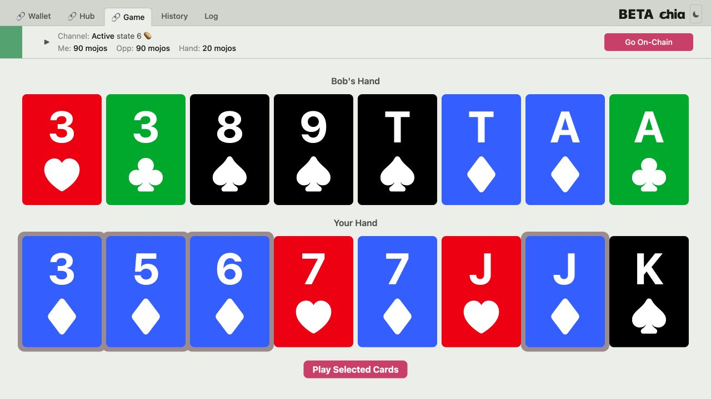
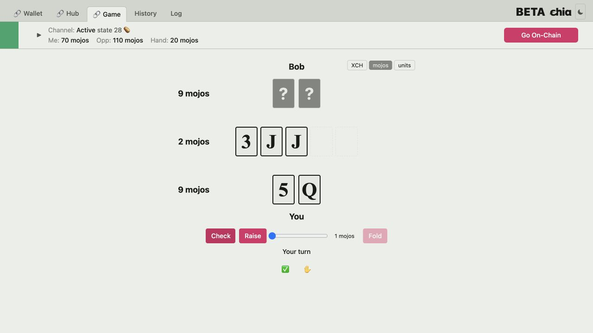
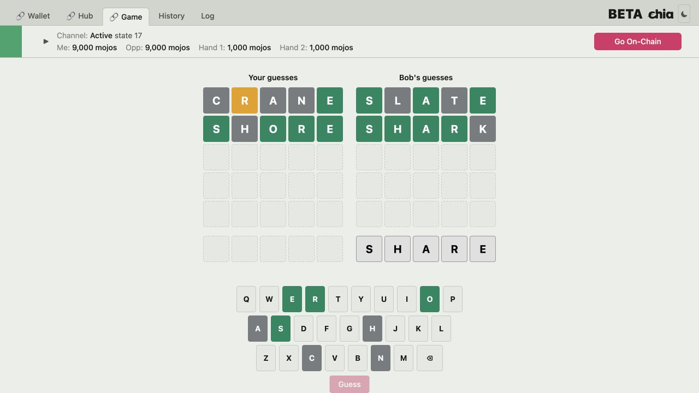

<div align="center">

# Chia Gaming

**Play two-player games for real stakes, directly against another person, with the rules enforced by the Chia blockchain.**

[Homepage](https://chia-network.github.io/chia-gaming/) ·
[Play in your browser](https://chia-network.github.io/chia-gaming/player/) ·
[Download](https://github.com/Chia-Network/chia-gaming/releases) ·
[Write a game](GAME_WRITING_GUIDE.md) ·
[Docs](#documentation)

[](https://github.com/Chia-Network/chia-gaming/releases)
[](https://github.com/Chia-Network/chia-gaming/actions/workflows/build-test.yml)
[](LICENSE)

<a href="https://chia-network.github.io/chia-gaming/player/">
  
</a>

</div>

> [!WARNING]
> Chia Gaming is in early beta. The games work end to end on mainnet, and you should still expect bugs. Try the built-in simulator first, and keep your stakes small.

## What is this?

Chia Gaming is a way for two people to play each other for XCH with nobody in the middle.

You and your opponent each put your stake into a shared coin on the Chia blockchain. From then on, every card you play and every bet you make is a signed message sent straight to the other player, so turns happen as fast as you can click. When you're finished, you both sign off on the final balances and the coin pays out. A whole session of play usually needs two transactions: one to open and one to close.

Each game's rules are written in Chialisp, which the blockchain itself can check. If your opponent tries an illegal move, you can prove it on-chain and take their stake. If they disappear halfway through a hand, a timeout lets you finish the game without them. You don't have to trust your opponent or any server along the way.

## A breakthrough for state channels

People have pitched state channels for years as the way to make blockchain apps fast. Real games are a tough fit, because the dispute logic has to cover every move of every game, including the awkward case where a player goes silent at the worst possible moment.

Chia Gaming handles that on mainnet today. It ships with an on-chain referee that can pick up any game from its last agreed state and play it out move by move. New games plug into that referee through a general API, so each one gets dispute handling for free. Put together, you can sit down with a stranger and play poker over a state channel for real money.

## Screenshots

<table>
  <tr>
    <td width="33%" align="center">
      <a href="project-page/images/calpoker-gameplay.jpg"></a>
      <br><b>California Poker</b><br>
      <sub>Both players pick cards in secret, commit to their choices, and reveal them together.</sub>
    </td>
    <td width="33%" align="center">
      <a href="project-page/images/spacepoker-gameplay.jpg"></a>
      <br><b>Space Poker</b><br>
      <sub>Heads-up poker in the style of Texas Hold'em, with betting rounds.</sub>
    </td>
    <td width="33%" align="center">
      <a href="project-page/images/krunk-gameplay.jpg"></a>
      <br><b>Krunk</b><br>
      <sub>A word game for two. Pick a secret word and race to crack your opponent's.</sub>
    </td>
  </tr>
</table>

## How it works

Here's the life of a game, step by step.

1. **Connect a wallet.** The player app works with WalletConnect, Sage and Cloud Wallet. There's also a local blockchain simulator if you'd like to try it with play money.
2. **Find an opponent on a hub.** A hub is a small server that lists players and passes messages between them. It only relays messages. Your keys and funds stay with you.
3. **Open a channel.** You and your opponent fund one shared channel coin on Chia.
4. **Play off-chain.** Moves travel back and forth using what we call the *potato protocol*. Only the player holding the potato can make the next move, which keeps both sides agreed on exactly where the game stands.
5. **Settle up.** When you're done, both players sign the final split and the channel closes. If one of you won't sign, the other can unroll the channel on-chain, and the referee coin plays out the rest of the game under the same rules.

The [overview](OVERVIEW.md) goes deeper into the coin structure, the referee, and how disputes are resolved.

## Play now

The fastest way in is the hosted player app:

**▶ [chia-network.github.io/chia-gaming/player](https://chia-network.github.io/chia-gaming/player/)**

Connect a wallet and choose a hub, and you can start proposing games. The player app is a static website made of HTML, JavaScript and WebAssembly, and it runs entirely in your browser.

Desktop builds for macOS, Windows and Linux are on the [releases page](https://github.com/Chia-Network/chia-gaming/releases), along with the player app and hub archives if you'd rather host them yourself.

## Run it from source

You'll need Rust (the pinned version installs itself through `rustup`), `wasm-pack` 0.15, Node 24, pnpm 10.33, and a `clang` that can target `wasm32`. [DEVELOPMENT.md](DEVELOPMENT.md) has the exact install commands.

```bash
git clone https://github.com/Chia-Network/chia-gaming.git
cd chia-gaming
./run-local-demo.sh
```

That builds everything and starts three services:

| Service              | URL                     |
| -------------------- | ----------------------- |
| Player app           | <http://localhost:3002> |
| Hub                  | <http://localhost:3003> |
| Blockchain simulator | <http://localhost:5800> |

To play against yourself, open the player app in two different browsers (or a normal and a private window) and choose **Continue with Simulator** in both. Run `./ct.sh` for the test suite.

## Host your own hub

Hubs are where players find each other, and anyone can run one. Each new hub gives people another place to play and makes the network less dependent on any one operator. If you have a spare server and a domain, please set one up.

Grab the hub archive from the [latest release](https://github.com/Chia-Network/chia-gaming/releases), unpack it, and start it with Node 24:

```bash
PORT=5801 node service.js --self https://hub.example.com/ --dir .
```

`--self` is the public URL players will use. Put it behind a reverse proxy that passes WebSocket upgrades through, then share the URL. Players paste it into the hub picker in the player app. You can also mount a hub under a path, like `https://example.com/hubs/beta/`. The [deployment notes](DEVELOPMENT.md#running-from-tarball-or-zipfile) cover that and the rest of the options.

## Add your own game

A game is a package under [`games/`](games) with its rules written in Chialisp. Those rules define every legal move, and they're what the blockchain checks if players end up in a dispute. Alongside them sit Rust tests that run the rules through the simulator and a React UI that talks to the player app through a small host API.

The simplest way to start is to copy the game closest to your idea. [`calpoker`](games/calpoker) is the smallest complete example. [`spacepoker`](games/spacepoker) shows several betting rounds, and [`krunk`](games/krunk) creates two linked games from one proposal. Add your package to [`games/registry.json`](games/registry.json) and it shows up in the app.

[GAME_WRITING_GUIDE.md](GAME_WRITING_GUIDE.md) walks through the whole thing with California Poker as the worked example. Anything with two players and a clear winner is a candidate.

## Project layout

```
src/            Rust core: channel state, potato protocol, referee, on-chain dispute handling
puzzles/        Rue puzzles, replacing the Chialisp ones (configured by Rue.toml)
clsp/           Chialisp puzzles for the referee and shared libraries, and the compiled puzzles
games/          Game packages (rules, tests, UI) and the game host API
wasm/           WebAssembly bindings so the Rust core runs in the browser
front-end/      The player app (React)
hub/            Hub service and its web UI
desktop/        Electron wrapper for the desktop builds
project-page/   The homepage you see at chia-network.github.io/chia-gaming
tools/          Build, release and test scripts
```

## Documentation

| Guide | Read it when you want to |
| --- | --- |
| [OVERVIEW.md](OVERVIEW.md) | understand state channels, the referee and the potato protocol |
| [GAME_WRITING_GUIDE.md](GAME_WRITING_GUIDE.md) | build a new game |
| [HANDLER_GUIDE.md](HANDLER_GUIDE.md) | go deeper on CLVM handlers and validators |
| [DEVELOPMENT.md](DEVELOPMENT.md) | build, test, package or deploy |
| [FRONTEND_ARCHITECTURE.md](FRONTEND_ARCHITECTURE.md) | work on the player app or hub |
| [PEER_PROTOCOL.md](PEER_PROTOCOL.md) | see the messages players exchange |
| [ON_CHAIN.md](ON_CHAIN.md) | follow what happens during a dispute |
| [DEBUGGING_GUIDE.md](DEBUGGING_GUIDE.md) | track down a failing test |

## Get involved

There's plenty to do, and you don't need to be a Chialisp expert to help.

- **Play** a few games and [open an issue](https://github.com/Chia-Network/chia-gaming/issues) when something breaks or feels off.
- **Run a hub** for your community.
- **Write a game** and send it in as a pull request.
- **Dig into the code.** Pull requests are welcome across the stack. Please run `./ct.sh` before you open one, and sign your commits, since CI checks for signatures.

## Security

If you find a security problem, please report it privately through [HackerOne](https://hackerone.com/chia_network). Valid reports are eligible for Chia's bug bounty. See [SECURITY.md](SECURITY.md).

## License

Chia Gaming is open source under the [Apache License 2.0](LICENSE).
